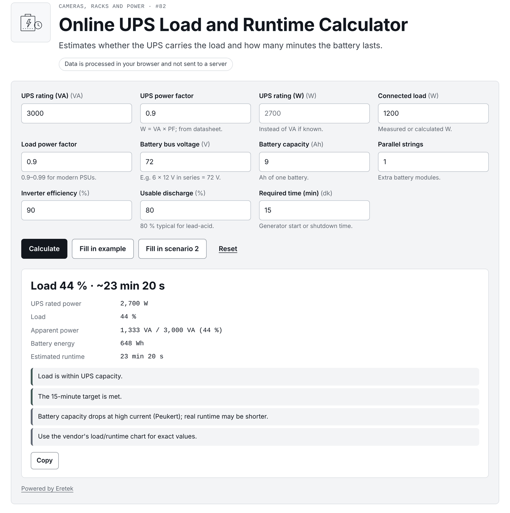

# UPS Load and Runtime Calculator

Calculate load percentage and approximate runtime during an outage from UPS VA/W rating, connected load and battery data; compare with the required time.

## Try it live

- [Türkçe](https://kamera.eretek.com/araclar/ups-yuk-calisma-suresi)
- [English](https://kamera.eretek.com/en/tools/ups-runtime-calculator)
- [Deutsch](https://kamera.eretek.com/de/werkzeuge/usv-laufzeitrechner)



## What it does

Estimates whether the UPS carries the load and how many minutes the battery lasts.

UPSs are sold by VA but the limit is usually the W rating (VA × power factor). Above 80 % load both life and runtime drop quickly. The tool checks load percentage by W and VA; with battery voltage and capacity it gives an approximate runtime from energy.

## Where it helps

Keep load below 80 %; if runtime is short, plan extra battery modules or a bigger UPS. Take the total load from the Power and Cooling tool or the PDU calculation.

## How to use it

1. Enter the UPS VA rating and power factor, or the W rating directly.
2. Enter the connected load (measured W).
3. Enter battery bus voltage, Ah and number of strings, optionally efficiency and depth of discharge; enter the target time and press Run.

### Fields

| Field | Description |
|---|---|
| UPS rating (VA) |  |
| UPS power factor | W = VA × PF; from datasheet. |
| UPS rating (W) | Instead of VA if known. |
| Connected load | Measured or calculated W. |
| Load power factor | 0.9–0.99 for modern PSUs. |
| Battery bus voltage | E.g. 6 × 12 V in series = 72 V. |
| Battery capacity | Ah of one battery. |
| Parallel strings | Extra battery modules. |
| Inverter efficiency |  |
| Usable discharge | 80 % typical for lead-acid. |
| Required time (min) | Generator start or shutdown time. |

## Example input

Press **Fill in example** in the tool to load this input.

| Input | Value |
|---|---|
| UPS rating (VA) | `3000` |
| UPS power factor | `0.9` |
| Connected load | `1200` |
| Load power factor | `0.9` |
| Battery bus voltage | `72` |
| Battery capacity | `9` |
| Parallel strings | `1` |
| Inverter efficiency | `90` |
| Usable discharge | `80` |
| Required time (min) | `15` |

**Expected result:** A 3000 VA / 2700 W UPS at 1200 W load is 44 %; a 72 V 9 Ah battery holds 648 Wh, about 23 min; the 15-minute target is met.

## Method and assumptions

Rated W = VA × PF (or the W entered). Load % = load / rated W. VA use = load / load PF. Energy (Wh) = bus voltage × Ah × strings. Runtime (h) = Wh × efficiency × depth of discharge / load.

## Limits and common mistakes

- Peukert effect, temperature, battery ageing and the UPS's own consumption are not in the linear model; the result does not replace vendor curves.

## Run it locally

The tool is plain HTML, CSS and JavaScript with no build step and no dependencies.

```bash
git clone https://github.com/eretek/ups-runtime-calculator.git
cd ups-runtime-calculator
node scripts/serve.js        # or: python3 -m http.server 8080
```

Open <http://127.0.0.1:8080/>. Add `?lang=tr` or `?lang=de` for Turkish or German; without it the page follows the browser language and falls back to English. You can also open `index.html` directly from disk.

Run the tests (Node.js 18 or later):

```bash
node test/run.js    # or: npm test
```

The tests run the tool's own fixtures and the worked examples in all three languages without a browser.

## How it works

All processing happens in your browser. The tool makes no network requests, uses no cookies or browser storage, and does not upload files you select.

No server-side component is needed. The version on the Eretek website renders the same page through a private WordPress plugin; that plugin only produces the page markup and is not part of this repository.

| Path | Purpose |
|---|---|
| `index.html` | Page shell |
| `src/app.js` | Builds the page in Turkish, English or German from `src/data.js` |
| `src/data.js` | Field definitions, examples and all texts in three languages |
| `src/core.js` | Shared runtime: validation, number formats, result rendering, CSV/ICS export |
| `src/tool.js` | The calculation or analysis for this tool |
| `docs/screenshot.png` | Screenshot used in this README |
| `src/tools.css`, `src/page.css` | Styles |
| `test/run.js`, `test/cases.json` | Headless tests |

## License and attribution

This tool is released under the [Eretek Website Attribution License](LICENSE). You may use, modify and redistribute it, including commercially. If you make it available on a website or web application, show a visible, clickable credit linking to https://eretek.com/ on every page where the tool is available, for example:

```html
<a href="https://eretek.com/">Powered by Eretek</a>
```

You may add `rel="nofollow"` to the link. Keep the copyright notice and license text in copies and redistributions.
